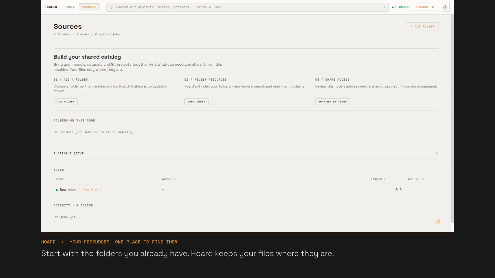

# Your first Hoard collection

[Watch the introduction with narration and captions](media/hoard-introduction.mp4).
The roughly 1 minute 42 second walkthrough starts with an empty catalog, adds a Git project
and model folder, then
finds, reviews and clones a project. It uses the real application with small synthetic
resources; no model weights or personal files appear in the recording.

[](media/hoard-introduction.mp4)

[Read the transcript](media/hoard-introduction-transcript.md) or
[download the captions](media/hoard-introduction.vtt).
The MP4 includes English narration and captions burned into the picture, so the explanations
remain available in players that do not support an external caption track. Narration is
synthesized locally with FFmpeg/libflite; no cloud voice service or music is used.

The recording uses an isolated loopback address. Sharing with another machine requires a
reachable LAN address and a listener that accepts that machine's connection. A configured
address is not proof of network reachability; check it from the receiving machine. Saving
node settings does not rebind or restart a running server.

## Reshoot the introduction

Requirements: Node.js 24 or newer, Git, FFmpeg with `libx264`, `libflite` and `drawtext`,
FFprobe, and a Chromium-based browser with the DevTools protocol. The default browser is
`/usr/bin/brave-browser`; pass `--browser /path/to/browser` or set `HOARD_BROWSER` otherwise.
The script uses installed tools and the vendored fonts. There are no npm packages or
runtime downloads. Run commands from the repository root on a POSIX system with `nice`.

Build the application first, using limited concurrency on a shared machine:

```sh
nice -n 10 cargo build --workspace -j 2
```

Run the journey without creating a video:

```sh
node scripts/record-introduction.mjs --verify
```

Record a new candidate rather than immediately replacing the published clip:

```sh
node scripts/record-introduction.mjs --output /tmp/hoard-introduction-candidate.mp4 --keep-work
```

Review the candidate, its transcript and the verification report. After accepting it,
regenerate the documented media in place:

```sh
node scripts/record-introduction.mjs --overwrite
```

Existing video, poster, transcript, caption and verification files are protected unless
`--overwrite` is explicitly passed. `--binary /path/to/hoard` selects a different build;
`--storyboard /path/to/storyboard.json` selects an alternate script. `--help` lists options.
The renderer uses two encoding threads and runs child processes with lowered priority.
Do not run it beside benchmarks or increase concurrency on a shared host.

The harness creates its own temporary catalog, browser profile, Git repository and three
small synthetic safetensors files. It starts on an available loopback port, with upstream
access and discovery disabled, and unsets inherited write/upstream tokens. No existing
configuration, catalog, source or service is used. It stops only its own process groups,
including on interruption. Successful runs remove scratch data unless `--keep-work` is
specified; failures retain it and print its path for diagnosis.

## Verify the wider first-run experience

The promotional journey is deliberately short. Run the separate browser acceptance harness
after changes to setup, empty states, configuration or Sources:

```sh
node scripts/verify-first-run.mjs
```

This uses the same built debug binary, Node.js and Brave, with its own synthetic fixtures,
write token, temporary catalog and ephemeral loopback port. It covers invalid-path recovery,
owner access, empty folders, typed input and focus through polling, form position while a
background scan finishes, active versus pending settings, restart, explicit empty queries,
shared details while setup status is unavailable, token storage and last-source removal.
It captures settled light/dark screenshots at 1180/1600px and prints the evidence directory.
No video encoding is involved. Existing artifact/loadout and shared-layout checks remain
part of the broader [UI change workflow](design/README.md#ui-change-workflow).

## Editing pace and content

The editable [storyboard](../scripts/introduction-storyboard.json) contains ordered scene
IDs, headings, captions, narration and minimum durations. The corresponding scene actions
in [the recorder](../scripts/record-introduction.mjs) operate the actual UI. When changing
an action or selector, run `--verify` before rendering. The recording fails if a required
screen or assertion is missing; it never substitutes a mock screenshot.

Narration is generated per scene with the offline `slt` voice, normalized, and placed after
a short lead-in. A scene lasts at least its configured duration or its narration duration
plus a reading pause, whichever is longer. Long actions extend the scene; speech is never
sped up to fit. Keep captions concise and allow time to read before moving to another task.

The 1920 by 1080 video contains the native 1600 by 900 application capture, centered above
a separate caption band. Cursor movement, typing and clicks use successive screenshots
from the running browser. Settled states are held deliberately for reading. This is a paced
walkthrough, not a claim about scan speed; actual waits are verified and edited out.
Product colors and the locally vendored Space fonts are reused for the caption treatment.

The journey verifies these outcomes before publishing output:

- Empty arrival opens setup in Sources, with no preconfigured folders or resources.
- A saved node name survives restarting the harness's own server and becomes active.
- Both folders are added through the web form and scanned into one mixed Index.
- Committed README content can be found and reviewed; relative documentation links and
  source-file previews work.
- COPY CLONE writes the expected project endpoint to the browser clipboard.
- An actual HTTP Git clone completes and its commit and README match the fixture.
- Sharing settings remain accessible after the first resources appear.
- The browser raises no uncaught exceptions.
- The rendered video decodes completely, contains H.264 video and AAC narration at the
  expected dimensions, and both streams continue through the complete scene timeline.
- Narration is non-silent and below clipping, with 100 to 200 spoken words per minute,
  a short lead-in and at least a second to read after each spoken scene.

Each full run writes a `-verification.json` report beside the MP4 with the checkout commit,
working-tree status, source-file SHA256 fingerprints, checks, scene durations, speech pace
and media properties. The harness fails if application or recording sources change during
capture; a dirty checkout is recorded explicitly rather than represented as a clean commit. The report is evidence for this journey, not
for all application behavior. Keep the broader first-run and existing-resource UX checks
from the design workflow separate, and review the generated video with sound before linking
an updated clip in the docs.
