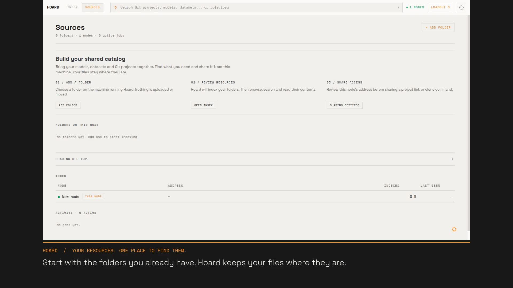

# Introduction to Hoard

[Watch the narrated introduction](../media/introduction/hoard-introduction.mp4)
(about 1 minute 40 seconds).

The walkthrough starts with an empty catalog, configures a node, adds synthetic Git and model
folders, searches their contents, reviews documentation and verifies an actual Git clone.
It uses the real application with isolated example resources.

- [Transcript](../media/introduction/hoard-introduction-transcript.md)
- [Spoken captions](../media/introduction/hoard-introduction.vtt)
- [Getting started guide](getting-started.md)
- [Reshoot this video](../../tasks/record-introduction/README.md)

The example listener is local to the recording machine. To share with another machine,
configure a reachable address and listener and test it from that machine.
